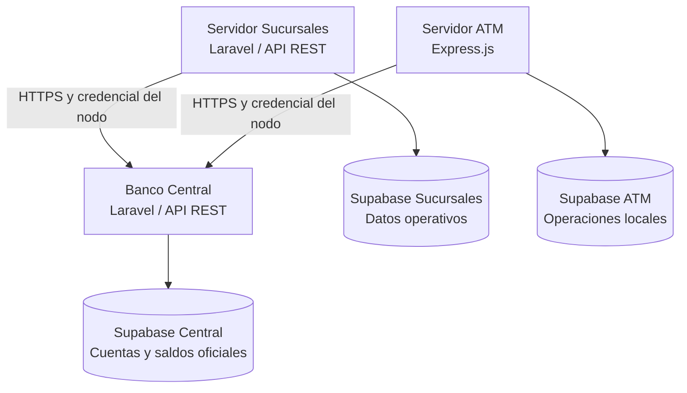

# Servidor Sucursales — Sistema Bancario Distribuido

> **Estado:** código base Laravel publicado en GitHub; integración, pruebas y despliegue público pendientes de verificación.

## Descripción

El **Servidor de Sucursales** es el nodo encargado de administrar la operación local de una sucursal bancaria: empleados, puestos, turnos, atención a clientes, solicitudes de servicio y auditoría. Forma parte del **Sistema Bancario Distribuido** desarrollado como examen práctico.

Las operaciones sobre cuentas bancarias y saldos oficiales deben solicitarse al **Banco Central** mediante una API autorizada. La sucursal utiliza su propia base de datos en **Supabase (PostgreSQL)** para información operativa local.

## Estado actual comprobado

| Componente | Estado |
| --- | --- |
| Repositorio GitHub | Disponible, con estructura de aplicación Laravel |
| Backend | Código Laravel publicado; funcionamiento de endpoints por verificar |
| Dependencias | `composer.json` requiere PHP `^8.3`, Laravel `^13.17` y Sanctum `^4.0` |
| Base de datos | Proyecto Supabase de Sucursales y siete tablas creadas |
| Integración con Banco Central | Pendiente de prueba de extremo a extremo |
| Despliegue Vercel | Acordado por el equipo; no se ha confirmado una URL pública funcional |
| OpenAPI | Pendiente de verificar o publicar |

**Repositorio:** https://github.com/Robel42-web/Servidor_sucursales

## Arquitectura general



**Principio fundamental:** Sucursales administra sus registros locales, pero **no modifica directamente los saldos oficiales** del Banco Central.

## Responsabilidades

- Administrar empleados y sus puestos de trabajo.
- Organizar turnos y asignaciones de personal.
- Registrar atención a clientes y solicitudes de servicio.
- Conservar registros de auditoría de actividades locales.
- Consultar información bancaria autorizada mediante la API del Banco Central.
- Solicitar operaciones bancarias al Banco Central cuando el backend las implemente.
- Proteger credenciales y manejar adecuadamente errores de comunicación.

## Tecnologías

| Tecnología | Uso |
| --- | --- |
| PHP 8.3 o superior | Lenguaje del backend |
| Laravel 13 | Aplicación y API REST |
| Laravel Sanctum | Dependencia de autenticación incluida en el proyecto; uso específico por verificar |
| Composer | Dependencias PHP |
| Supabase / PostgreSQL | Persistencia de datos operativos de sucursales |
| GitHub | Repositorio y control de versiones |
| Vercel | Plataforma de despliegue acordada, pendiente de validación |

## Base de datos de Sucursales

El proyecto de Supabase **`servidor-sucursales`** tiene las siguientes siete tablas:

| Tabla | Propósito |
| --- | --- |
| `job_positions` | Catálogo de puestos laborales |
| `employees` | Empleados y puestos asignados |
| `work_shifts` | Definición de turnos |
| `employee_shifts` | Asignación de empleados a turnos |
| `customer_service_records` | Registro de atención a clientes |
| `service_requests` | Solicitudes de servicio y seguimiento |
| `audit_logs` | Bitácora de acciones y eventos |

El esquema inicial contempla UUID, relaciones mediante claves foráneas y controles de acceso con RLS. Los permisos efectivos deben validarse con el backend y las credenciales que se utilicen.

La base de datos de Sucursales es **independiente** de las bases de Banco Central y ATM.

## Reglas de negocio

1. Cada empleado debe relacionarse con un puesto válido.
2. Los turnos deben asignarse a empleados y horarios existentes.
3. Los registros de atención y solicitudes deben conservar referencias consistentes.
4. Las acciones importantes deben registrarse para auditoría.
5. Las solicitudes bancarias al Banco Central deben autenticarse y utilizar HTTPS.
6. Sucursales no debe utilizar credenciales privadas de la base de datos del Banco Central.
7. El Banco Central es la fuente de verdad para saldos y transacciones oficiales.
8. Una operación monetaria no debe considerarse exitosa sin confirmación del Banco Central.

## API y funcionalidades

El repositorio ya incluye una carpeta `routes`, pero **no se han verificado aquí los métodos y rutas concretos**. Por ello, esta tabla describe las áreas previstas y no constituye una lista de endpoints implementados.

| Área | Funcionalidad esperada | Verificación |
| --- | --- | --- |
| Empleados | Consultar y administrar empleados | Pendiente |
| Puestos | Consultar puestos de trabajo | Pendiente |
| Turnos | Gestionar horarios y asignaciones | Pendiente |
| Atención | Registrar atenciones a clientes | Pendiente |
| Solicitudes | Registrar y consultar solicitudes | Pendiente |
| Auditoría | Consultar eventos autorizados | Pendiente |
| Banco Central | Consultar cuentas y solicitar operaciones autorizadas | Pendiente |

Los endpoints reales deben documentarse a partir de `routes/api.php`, los controladores y sus pruebas. La especificación OpenAPI (`openapi.yaml` o equivalente) queda pendiente de confirmación.

## Instalación local

**Requisitos:** PHP compatible con `composer.json`, Composer y acceso a la base de datos correspondiente.

```bash
git clone https://github.com/Robel42-web/Servidor_sucursales.git
cd Servidor_sucursales
composer install
```

Si se dispone de `.env.example`, crear la configuración local y generar la clave:

```bash
cp .env.example .env
php artisan key:generate
```

En Windows, el comando de copia puede ser `copy .env.example .env`.

**Importante:** antes de ejecutar `php artisan migrate`, revisar las migraciones y las tablas existentes en Supabase para evitar cambios accidentales sobre el esquema ya creado.

### Variables de entorno de referencia

Los siguientes nombres son ejemplos; deben ajustarse a los que realmente utiliza el código. **No incluyen secretos reales.**

```dotenv
APP_NAME="Servidor Sucursales"
APP_ENV=local
APP_DEBUG=true
APP_KEY=
APP_URL=http://localhost:8000

DB_CONNECTION=pgsql
DB_HOST=HOST_DE_SUPABASE_O_POOLER
DB_PORT=5432
DB_DATABASE=postgres
DB_USERNAME=USUARIO_POSTGRES
DB_PASSWORD=CONTRASENA_PRIVADA
DB_SSLMODE=require

CENTRAL_API_URL=https://URL_REAL_DEL_BANCO_CENTRAL
CENTRAL_NODE_API_KEY=CLAVE_PRIVADA_DEL_NODO
```

Si se utiliza el **Session pooler** de Supabase, el host y el usuario se obtienen del panel de conexión del proyecto. `CENTRAL_NODE_API_KEY` es una credencial del Banco Central, **no** la clave secreta de Supabase.

Para un despliegue de producción se recomienda `APP_ENV=production` y `APP_DEBUG=false`.

## Despliegue en Vercel

El equipo acordó utilizar **Vercel para los tres nodos**, con autorización del profesor. Para Sucursales, el despliegue y su disponibilidad pública **aún no se han confirmado**.

| Elemento | Estado |
| --- | --- |
| Repositorio | https://github.com/Robel42-web/Servidor_sucursales |
| Plataforma elegida | Vercel |
| URL pública de Sucursales | Pendiente de confirmar |
| Despliegue automático desde GitHub | Pendiente de comprobar |
| Conexión con Supabase | Pendiente de prueba desde el despliegue |
| Comunicación con Banco Central | Pendiente de prueba |

**Consideración técnica:** Laravel requiere una estrategia de ejecución PHP compatible con Vercel. Un despliegue marcado como `Ready` no garantiza que las rutas funcionen; es necesario probar las respuestas HTTP y revisar los logs de ejecución.

## Prueba funcional propuesta

1. Registrar o consultar un empleado y su puesto.
2. Asignarle un turno de trabajo.
3. Registrar una atención a clientes o solicitud de servicio.
4. Verificar el registro correspondiente en la base de datos de Sucursales.
5. Consultar información autorizada de una cuenta mediante el Banco Central.
6. Confirmar que la sucursal no modifica directamente el saldo oficial.
7. Revisar la auditoría de las acciones ejecutadas.

**Esta secuencia describe pruebas esperadas, no pruebas ya completadas.**

## Evidencias y pendientes

- Verificar las rutas API y documentar métodos, parámetros y respuestas.
- Generar o localizar la especificación OpenAPI.
- Comprobar conexión efectiva con Supabase.
- Configurar y verificar el despliegue en Vercel.
- Registrar la URL pública cuando exista.
- Probar la comunicación con Banco Central y documentar resultados.
- Adjuntar capturas de ejecución y logs relevantes para la entrega.

## Repositorios relacionados

- **Banco Central:** https://github.com/Robel42-web/Banco_central
- **Servidor Sucursales:** https://github.com/Robel42-web/Servidor_sucursales
- **Servidor ATM:** https://github.com/Robel42-web/Servidor_atm

---

**Proyecto académico:** Examen Práctico — Sistema Bancario Distribuido.
