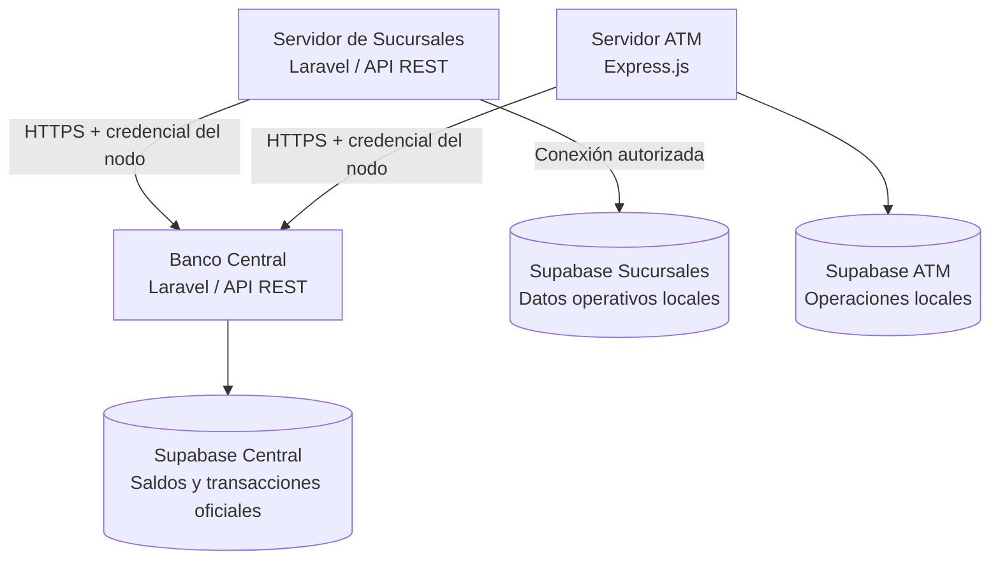

# Servidor Sucursales — Sistema Bancario Distribuido

> **Estado del proyecto:** en desarrollo. Este README es una versión inicial; se actualizará cuando el equipo publique el código y verifique la aplicación.

## Descripción

El **Servidor de Sucursales** es uno de los nodos del Sistema Bancario Distribuido desarrollado como examen práctico. Su función es administrar la **operación local de una sucursal bancaria**, incluyendo empleados, puestos, turnos, atención a clientes, solicitudes de servicio y registros de auditoría.

Para las operaciones que afectan cuentas y dinero, la sucursal debe comunicarse con la **API del Banco Central**, que conserva los saldos oficiales y el historial global de transacciones. La aplicación está prevista con **Laravel (PHP)** y una base de datos independiente en **Supabase (PostgreSQL)**. El equipo acordó desplegar los tres nodos en **Vercel**, previa validación de compatibilidad de Laravel.

## Arquitectura general



**Principio fundamental:** el Servidor Sucursales administra sus datos operativos, pero **no modifica directamente los saldos oficiales**. Las operaciones bancarias se solicitan al Banco Central a través de endpoints autorizados.

## Responsabilidades del Servidor Sucursales

- Administrar empleados y sus puestos de trabajo.
- Organizar turnos y asignaciones de personal.
- Registrar atenciones a clientes realizadas en la sucursal.
- Registrar y dar seguimiento a solicitudes de servicio.
- Mantener bitácoras de auditoría de acciones locales.
- Consultar información bancaria autorizada a través de la API del Banco Central.
- Solicitar operaciones sobre cuentas al Banco Central, según las funciones que implemente el equipo.
- Proteger las credenciales de conexión y limitar el acceso a información sensible.

## Tecnologías previstas

| Tecnología | Uso |
| --- | --- |
| PHP / Laravel | Backend y API de sucursales |
| Composer | Gestión de dependencias PHP |
| Supabase / PostgreSQL | Persistencia de la información operativa local |
| API REST / HTTPS | Comunicación autorizada con el Banco Central |
| GitHub | Control de versiones |
| Vercel | Plataforma de despliegue acordada por el equipo |

## Base de datos de Sucursales

El esquema inicial preparado para el proyecto `servidor-sucursales` contempla **siete tablas**:

| Tabla | Propósito |
| --- | --- |
| `job_positions` | Catálogo de puestos laborales |
| `employees` | Información de empleados y sus puestos |
| `work_shifts` | Definición de turnos de trabajo |
| `employee_shifts` | Asignación de empleados a turnos y fechas |
| `customer_service_records` | Registros de atención a clientes |
| `service_requests` | Solicitudes de servicio y su seguimiento |
| `audit_logs` | Registro de acciones y eventos de auditoría |

El esquema inicial utiliza identificadores UUID, claves foráneas e índices para las relaciones y consultas frecuentes. Se habilitó RLS y se restringió el acceso directo de los roles públicos; las políticas y permisos definitivos deberán validarse con el backend.

**Importante:** esta base de datos es independiente de la del Banco Central y de la del ATM. No se deben copiar ni actualizar saldos oficiales en Sucursales como fuente de verdad.

## Reglas de negocio principales

1. Los registros de empleados deben respetar las relaciones con los puestos existentes.
2. Las asignaciones de turnos deben asociarse con empleados y turnos válidos.
3. Las atenciones y solicitudes deben conservar referencias consistentes cuando correspondan.
4. Las acciones relevantes deben quedar registradas para auditoría.
5. Las solicitudes al Banco Central deben realizarse por HTTPS y autenticarse como nodo autorizado.
6. Las credenciales de Supabase del Banco Central **no** deben distribuirse al Servidor Sucursales.
7. Los saldos y transacciones oficiales deben obtenerse o actualizarse exclusivamente mediante la API del Banco Central.
8. Los errores de comunicación con el Banco Central deben manejarse sin registrar una operación monetaria como exitosa si no fue confirmada.

## Contrato inicial de la API (pendiente de implementación)

Las siguientes son **áreas funcionales previstas**, no rutas confirmadas. Los nombres, métodos y respuestas se definirán con el compañero responsable cuando publique el código.

| Área | Funcionalidad prevista | Estado |
| --- | --- | --- |
| Empleados | Consultar y administrar empleados | Pendiente de confirmar |
| Puestos | Consultar puestos laborales | Pendiente de confirmar |
| Turnos | Gestionar turnos y asignaciones | Pendiente de confirmar |
| Atención | Registrar y consultar atenciones a clientes | Pendiente de confirmar |
| Solicitudes | Registrar y dar seguimiento a solicitudes | Pendiente de confirmar |
| Auditoría | Consultar registros autorizados | Pendiente de confirmar |
| Integración central | Consultar cuentas o solicitar operaciones al Banco Central | Pendiente de confirmar |

La documentación definitiva de rutas, parámetros, respuestas, autenticación y códigos HTTP se publicará mediante **OpenAPI** cuando exista la implementación.

## Configuración local (pendiente de validar con el código)

Cuando el repositorio contenga una aplicación Laravel, el procedimiento habitual será:

```bash
git clone https://github.com/Robel42-web/Servidor_sucursales.git
cd Servidor_sucursales
composer install
cp .env.example .env
php artisan key:generate
```

Después se configurarán las variables de entorno y se ejecutarán los comandos de inicio y pruebas que confirme el desarrollador. **No ejecutes migraciones sobre Supabase sin comprobar antes las tablas existentes.**

### Variables de entorno de referencia

Los nombres exactos deberán ajustarse a la implementación real. Los siguientes valores son **marcadores de ejemplo**, no credenciales:

```dotenv
APP_ENV=local
APP_DEBUG=true
APP_KEY=

DB_CONNECTION=pgsql
DB_HOST=HOST_POSTGRES_SUCURSALES
DB_PORT=5432
DB_DATABASE=postgres
DB_USERNAME=USUARIO_POSTGRES
DB_PASSWORD=CONTRASENA_PRIVADA
DB_SSLMODE=require

SUPABASE_URL=https://PROYECTO_SUCURSALES.supabase.co
SUPABASE_PUBLISHABLE_KEY=CLAVE_PUBLICABLE
SUPABASE_SECRET_KEY=CLAVE_SECRETA_SOLO_BACKEND

CENTRAL_API_URL=https://URL_PUBLICA_DEL_BANCO_CENTRAL
CENTRAL_NODE_API_KEY=CLAVE_PRIVADA_ASIGNADA_A_LA_SUCURSAL
```

> El backend podría utilizar PostgreSQL directo, la API de Supabase o ambas. No todas las variables serán necesarias en todos los casos. Para una conexión PostgreSQL desde un entorno solo IPv4, podría ser necesario utilizar el **Session pooler** de Supabase, cuyos valores de host y usuario son distintos de los de la conexión directa.

**Seguridad:** nunca subir archivos `.env`, contraseñas, tokens de GitHub ni claves secretas a GitHub. Mantener un `.env.example` con valores ficticios y configurar los secretos reales únicamente en el backend y en las variables privadas de Vercel. La clave de nodo para Banco Central es diferente de las claves secretas de Supabase.

## Despliegue previsto en Vercel

El equipo acordó utilizar **Vercel para los tres nodos**, con autorización del profesor. Este repositorio se vinculará a un proyecto independiente de Vercel.

**Importante:** Vercel no ofrece un servidor PHP/Laravel persistente convencional. Antes de desplegar, el equipo debe definir y comprobar una estrategia compatible de ejecución PHP, además de revisar rutas, dependencias, sesiones, almacenamiento temporal y variables de entorno. **No se considera completado el despliegue hasta probar la API publicada.**

- **Repositorio:** https://github.com/Robel42-web/Servidor_sucursales
- **URL pública:** pendiente de despliegue.
- **Despliegue automático desde GitHub:** pendiente de configurar y verificar.
- **Comunicación con Banco Central:** pendiente de pruebas de integración.

## Prueba funcional esperada

1. El administrador registra o consulta un empleado y su puesto.
2. Asigna al empleado un turno de trabajo.
3. Registra una atención o solicitud de servicio asociada a la sucursal.
4. La sucursal consulta una cuenta autorizada mediante la API del Banco Central.
5. Banco Central devuelve la información oficial sin permitir que la sucursal altere directamente los saldos.
6. Se comprueba que la actividad local relevante queda registrada para auditoría.

Esta secuencia es una **propuesta de validación**, no evidencia de pruebas ya realizadas. Se ajustará a las funciones que finalmente implemente el equipo.

## Documentación adicional (pendiente)

- Archivo OpenAPI (`openapi.yaml` o equivalente).
- Capturas de pruebas y respuestas de la API.
- URL pública del proyecto en Vercel.
- Evidencia de despliegue continuo desde GitHub.
- Instrucciones definitivas de instalación y pruebas.
- Confirmación de rutas reales y credenciales de nodo configuradas.

## Equipo y repositorios relacionados

- **Banco Central:** https://github.com/Robel42-web/Banco_central
- **Servidor Sucursales:** https://github.com/Robel42-web/Servidor_sucursales
- **Servidor ATM:** https://github.com/Robel42-web/Servidor_atm

Proyecto académico: **Examen Práctico — Sistema Bancario Distribuido**.
